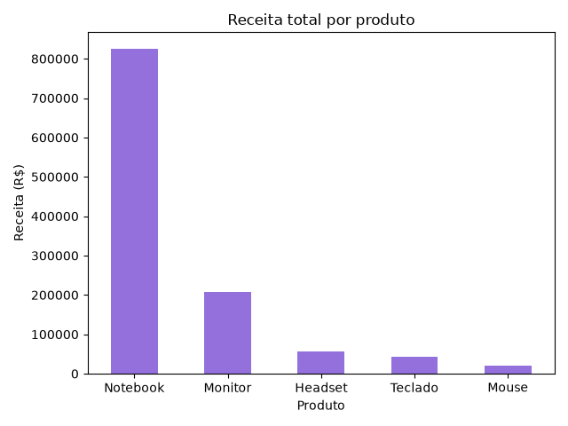
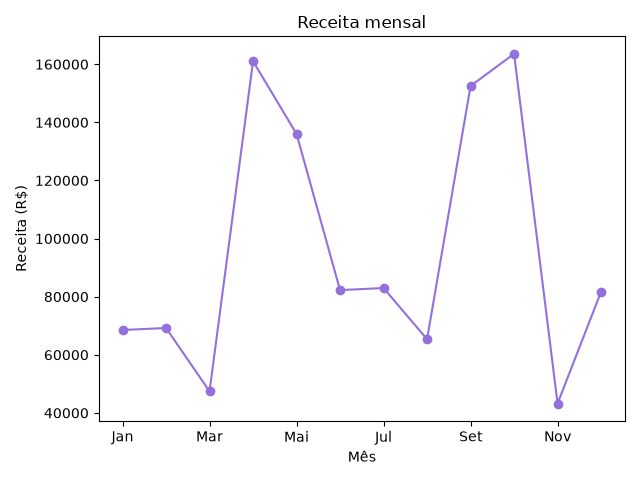

# Análise de Vendas com Python

Projeto de análise de dados que simula as vendas de uma loja de informática
durante um ano e identifica os produtos e meses com maior receita.

## Tecnologias
- Python
- Pandas
- Matplotlib

## O que o projeto faz
- Gera uma base de vendas fictícia (`vendas.csv`)
- Calcula receita total, por produto e por mês
- Identifica o produto mais vendido e o melhor mês
- Gera gráficos com os resultados

## Como rodar
1. Instale as dependências: `pip install pandas matplotlib`
2. Execute: `python analise.py`

## Resultados

### Receita por produto

### Receita mensal

## Aprendizados
- Manipulação de dados com Pandas (groupby, ordenação, agregações)
- Criação de gráficos com Matplotlib
- Organização de um projeto de análise do início ao fim

Os dados são fictícios.